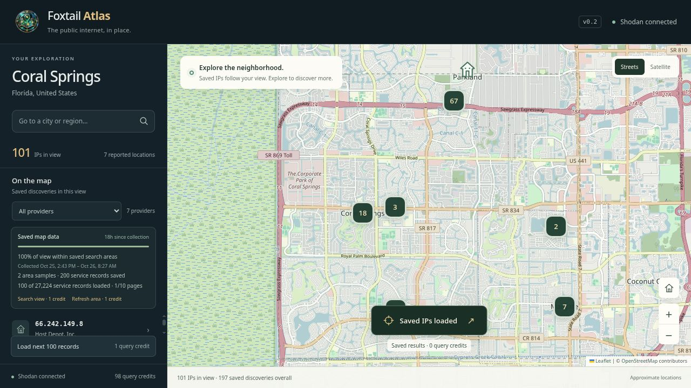
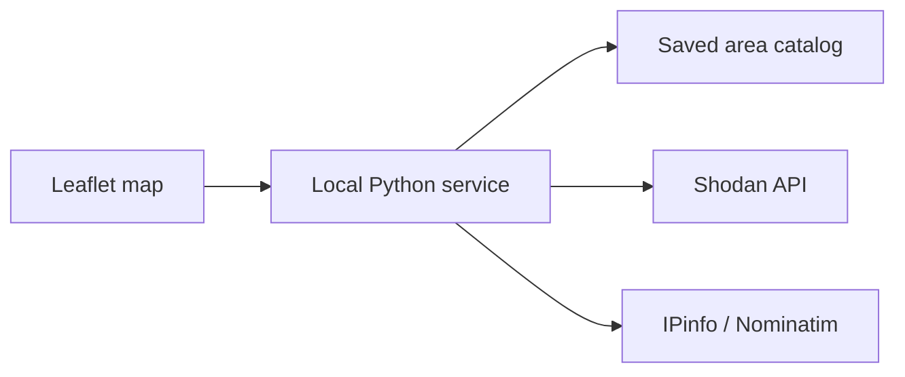

# Foxtail Atlas

**Explore the public internet by place.**

Atlas puts Shodan's indexed public IPv4 observations on a street or satellite
map. Browse a neighborhood, inspect providers and services, and return to saved
discoveries without spending another search credit.



## What works

- Geographic discovery, provider filters, and clusters for shared locations.
- IP details with ASN, organization, indexed ports, observation time, and a
  second location estimate when available.
- Persistent saved areas, reuse after small map movements, and an in-memory
  index rebuilt only when saved files change.
- Collection age, sampled search footprints, page progress, and visible credit
  costs. Saved data never triggers an automatic paid refresh.
- Serialized paid requests, duplicate-refresh protection, same-origin checks,
  and a per-session request token. The service listens on loopback only.

**Status:** v0.2, working Linux desktop application. The browser interface also
runs directly from the Python service. The Foxtail installer is specific to an
existing Foxtail desktop; it is not a general Linux installer.

## Run locally

Requires Python 3.11+ and a Shodan API key with filtered-search access. No extra
Python packages are required. Put your own key in `~/.config/shodan/api_key`
with owner-only permissions; keep it out of this repository.

```bash
python3 server.py
```

Open <http://127.0.0.1:18864/>. Atlas starts at Coral Springs, Florida. Select
**Explore this area** to request a sample, or browse already saved results.
Filtered searches/new pages use one Shodan query credit for up to 100 service
records. Account access and quotas depend on your Shodan subscription.

## How it works



The service owns the API key, paid-request lock, geographic matching, and saved
catalog. The frontend requests a free view of known observations as the map
moves. A deliberate action is required to search, refresh, or load another page.
The most recently collected snapshot determines an IP's position.

## Checks

```bash
python3 -m unittest -v test_server.py
node --check static/app.js
```

The 17 regression tests cover bounds validation, public IPv4 normalization,
overlapping footprints, stale-data reuse, persistence, moved IPs, failed
refreshes, concurrent requests, refresh pagination, and HTTP request protection.
They use synthetic or mocked data and do not spend Shodan credits.

## Limits and data sources

Search results are samples of indexed **services**, not a complete inventory or
a count of every IP in an area. A building marker represents an estimated
network location; it does not identify a household. Footprint percentage shows
saved query boundaries, not completeness. There are up to ten pages per area.
After 24 hours, refresh that area explicitly before requesting additional pages.

Map data: OpenStreetMap contributors. Satellite imagery: Esri and its imagery
partners. Search observations: Shodan. Place navigation: Nominatim. Optional
location context: IPinfo. Provider terms and availability apply.
Leaflet and Leaflet.markercluster are vendored with their licenses in
`static/vendor/`. The icon was produced with AI-assisted image generation.
